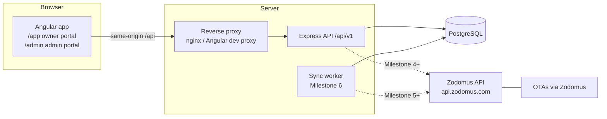
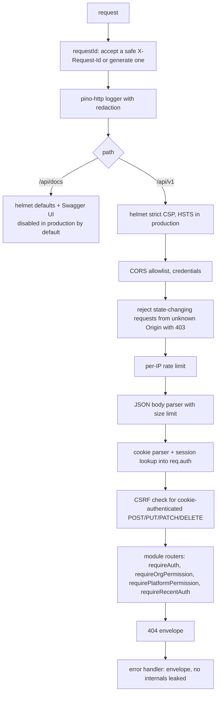

# Architecture

StaySync is a **modular monolith**: one deployable API and one Angular app, with module
boundaries that mirror the service areas in `Architecture/SaaS Hotel Channel Management Architecture.png`
(Auth, Property, Inventory, Rates, Booking, Channel Manager, Notification, Reporting, Billing).
Modules can be extracted into services later without rewriting business logic.



The browser never talks to Zodomus. Credentials live only in the API's environment.

## API layering

Each module under `apps/api/src/modules/<name>/` is split into:

| Layer | Responsibility |
|---|---|
| `http/` | routes, request parsing with Zod, response envelope, status codes |
| `application/` | use cases and workflows; depends on interfaces only |
| `domain/` | entities, rules, interfaces (for example `ChannelProvider`) |
| `infrastructure/` | Prisma repositories, external API clients |

Modules so far: `health` (M1); `auth`, `audit`, `rbac`, `organizations`, `admin` (M2); plus cross-cutting
`config`, `middleware`, `shared`, `openapi` and `infrastructure` (database, tenancy, mail). `src/container.ts`
is the composition root that wires implementations to the interfaces modules depend on.

## Request pipeline



Response envelopes:

```json
{ "data": { } , "meta": { } }
{ "error": { "code": "VALIDATION_FAILED", "message": "…", "details": [], "requestId": "…" } }
```

## Client IP and proxies

`TRUST_PROXY` maps to Express `trust proxy`. The default `false` ignores `X-Forwarded-For`,
so clients cannot spoof their IP to dodge rate limits. Behind the example nginx config
(which overwrites `X-Forwarded-For` with the peer address) use `TRUST_PROXY=1`.
`true` is rejected at startup.

## Authentication (Milestone 2)

```mermaid
sequenceDiagram
  autonumber
  participant B as Browser (Angular)
  participant A as API
  participant D as PostgreSQL
  B->>A: POST /auth/login {email, password}
  A->>D: find user (system context)
  alt unknown email / wrong password / locked
    A->>A: Argon2id verify (dummy hash for unknown emails)
    A->>D: count failure, maybe lock (capped exponential backoff)
    A-->>B: 401 INVALID_CREDENTIALS (same response in every case)
  else correct password
    A->>D: create session (store SHA-256 of token + CSRF token)
    A-->>B: Set-Cookie ss_session (HttpOnly, SameSite=Lax) + ss_csrf (readable); state
  end
  opt 2FA enabled (state = mfa_pending)
    B->>A: POST /auth/2fa/verify {code | recoveryCode} + X-CSRF-Token
    A->>A: TOTP check (+/-1 step, replay-protected) or one-time recovery code
    A->>D: revoke pending session, create a new one (rotation)
    A-->>B: new cookies; state = authenticated
  end
  opt 2FA mandatory but not enrolled (platform roles, org policy)
    A-->>B: state = mfa_enrollment_required (only setup endpoints allowed)
  end
```

Session rules:

- Opaque random token (256-bit) in an HttpOnly cookie (`__Host-ss_session` when Secure). Only its SHA-256 is stored.
- Absolute lifetime `SESSION_TTL_HOURS` (default 7 days), idle timeout `SESSION_IDLE_MINUTES` (default 12 h).
- Revoked on logout, password change (other sessions) and password reset (all sessions). Users can list and revoke sessions.
- CSRF: synchronizer token bound to the session, sent back by Angular in `X-CSRF-Token`, compared in constant time.
  Anonymous POSTs (login, register, reset) rely on the Origin allowlist plus the JSON-only body parser.
- Step-up: sensitive actions (change password, 2FA setup/disable, recovery codes, org security policy, admin unlock)
  need a fresh login or `POST /auth/step-up` (password + TOTP) within `STEP_UP_WINDOW_MINUTES`.

Secrets at rest:

| Secret | Stored as |
|---|---|
| Password | Argon2id hash (m=19 MiB, t=2, p=1 by default; rehashed on login when parameters change) |
| Session token, CSRF token, email/reset tokens | SHA-256 hash |
| TOTP secret | AES-256-GCM ciphertext, key derived (HKDF) from `DATA_ENCRYPTION_KEY`, bound to the user id |
| Recovery codes | HMAC-SHA256 with a separate derived key (codes are high-entropy and single-use) |

## Authorization and tenant isolation (Milestone 2)

- **RBAC.** Organization roles (`ORG_OWNER`, `PROPERTY_MANAGER`, `PROPERTY_STAFF`, `READ_ONLY`) map to permissions
  in `modules/rbac/permissions.ts`. Platform roles (`PLATFORM_SUPER_ADMIN`, `PLATFORM_SUPPORT`) have only `admin.*`
  permissions. They get **no** implicit access to tenant data or guest PII.
- **Tenant routes** use `requireOrgPermission(...)`. Non-members get 404, so organization ids cannot be probed.
- **Row-level security.** Tenant tables have `FORCE ROW LEVEL SECURITY` policies on `app.org_id`. Handlers run in
  `withTenant(db, orgId, fn)`, which sets the setting for one transaction. System work (auth lookups, admin views,
  seeding) uses `withSystem`. A query that forgets its tenant filter returns only that tenant's rows. A query with
  no context returns nothing (fail closed).
- **Least-privilege database role.** The API connects as `staysync_app` (not owner, not superuser, `NOBYPASSRLS`, no
  UPDATE/DELETE on `audit_events`). Migrations run as the owner through `MIGRATION_DATABASE_URL`.
- Caveat: any role can set `app.*` settings. RLS protects against application bugs, not against an attacker who can
  already run arbitrary SQL. Prisma's parameterized queries are the defense against SQL injection.

## Data model

```mermaid
erDiagram
  organizations ||--o{ organization_memberships : has
  users ||--o{ organization_memberships : "member of"
  users ||--o{ sessions : has
  users ||--o{ recovery_codes : has
  users ||--o{ one_time_tokens : has
  users {
    uuid id PK
    varchar email UK "lower-case (CHECK)"
    varchar password_hash "argon2id"
    platform_role platform_role "NULL for customers"
    timestamptz email_verified_at
    varchar totp_secret_enc "AES-256-GCM"
    bigint totp_last_used_step "replay guard"
    int failed_login_count
    timestamptz locked_until
  }
  organization_memberships {
    uuid organization_id FK
    uuid user_id FK
    organization_role role "unique (org, user)"
  }
  sessions {
    uuid id PK
    char token_hash UK "sha256"
    char csrf_token_hash
    timestamptz mfa_verified_at
    timestamptz step_up_at
    timestamptz expires_at
    timestamptz revoked_at
  }
  recovery_codes {
    uuid user_id FK
    char code_hash "hmac-sha256"
    timestamptz used_at
  }
  one_time_tokens {
    uuid user_id FK
    one_time_token_purpose purpose "VERIFY_EMAIL | PASSWORD_RESET | EMAIL_CHANGE"
    char token_hash UK
    timestamptz expires_at
    timestamptz used_at
  }
  organizations ||--o{ properties : owns
  organizations ||--o{ audit_events : "scoped to (optional)"
  organizations {
    uuid id PK "UUIDv7"
    varchar slug UK "a-z0-9 and dashes (CHECK)"
    varchar name
    organization_status status
    char default_currency "ISO 4217 (CHECK)"
    timestamptz created_at
    timestamptz updated_at
  }
  properties {
    uuid id PK
    uuid organization_id FK "ON DELETE RESTRICT"
    varchar name "unique per organization"
    property_type property_type
    property_status status
    varchar timezone "IANA, validated by trigger"
    char currency
    char country_code
    varchar check_in_time "HH:MM (CHECK)"
    varchar check_out_time "HH:MM (CHECK)"
  }
  properties ||--o{ room_types : has
  room_types ||--o{ rooms : "has (FK property_id, room_type_id)"
  organizations ||--|| subscriptions : has
  plans ||--o{ subscriptions : "priced by"
  organizations ||--o{ invitations : sends
  organizations ||--o{ support_access_requests : "approves"
  room_types {
    uuid id PK
    uuid organization_id
    uuid property_id "FK (organization_id, property_id)"
    varchar code "unique per property, A-Z0-9_-"
    varchar name "unique per property"
    int base_occupancy "CHECK max >= base"
    int max_adults
    int max_children
    int max_occupancy "CHECK <= adults + children"
    text_array amenities
    room_type_status status
  }
  rooms {
    uuid id PK
    uuid organization_id
    uuid property_id
    uuid room_type_id "FK (property_id, room_type_id)"
    varchar name "unique per property (case-insensitive)"
    varchar floor
    room_status status "AVAILABLE | OUT_OF_SERVICE"
  }
  plans {
    uuid id PK
    varchar code UK "FREE | PRO | PREMIUM"
    int max_properties
    int max_users
    int max_channels
    int price_monthly_minor "paise"
  }
  subscriptions {
    uuid organization_id UK
    uuid plan_id FK
    subscription_status status
    timestamptz trial_ends_at
  }
  invitations {
    uuid id PK
    uuid organization_id
    varchar email
    organization_role role
    char token_hash UK
    timestamptz expires_at "7 days"
    timestamptz accepted_at
    timestamptz revoked_at
  }
  support_access_requests {
    uuid id PK
    uuid organization_id
    uuid requested_by_id
    varchar reason
    int duration_minutes
    support_access_status status
    uuid decided_by_id
    timestamptz expires_at
  }
  integration_call_logs {
    uuid id PK
    varchar provider
    varchar environment "sandbox | production (CHECK)"
    varchar operation
    varchar path
    int http_status
    integration_call_outcome outcome
    int duration_ms
    int attempts
    varchar error_message "generic, no bodies"
    int provider_code "Zodomus status.returnCode"
    varchar provider_message "Zodomus status.returnMessage"
    varchar request_id
  }
  provider_reference_data {
    uuid id PK
    varchar kind "account | channels | currencies | price_models"
    jsonb payload "sanitized, <= 1 MB"
    int item_count
    timestamptz fetched_at
  }
  audit_events {
    uuid id PK
    uuid organization_id FK "nullable"
    uuid actor_user_id
    varchar action
    varchar entity_type
    varchar entity_id
    varchar request_id
    inet ip_address
    jsonb metadata
    timestamptz created_at
  }
```



Conventions:

- UUIDv7 primary keys (time-ordered, index friendly).
- All timestamps are `timestamptz` in UTC; each property stores its IANA time zone.
- Tenant-owned tables carry `organization_id` and a unique `(organization_id, id)` key so
  child tables use tenant-safe composite foreign keys (room types → properties, rooms → room types).
- `audit_events` is append-only: a trigger blocks `UPDATE`, `DELETE` and `TRUNCATE`.
- Rules Prisma cannot express (CHECK constraints, triggers) live in hand-written migrations.
  Prisma ignores them when diffing, so they do not cause drift. CI checks for drift.

RLS (`FORCE ROW LEVEL SECURITY`) covers properties, room types, rooms, subscriptions, invitations and support access
requests. `plans` is read-only for the application role. Rate plans, inventory, bookings, channel mappings and sync jobs
arrive in later milestones.

## Channel providers (Milestone 4)

```text
Angular (admin / owner) --/api/v1--> channels.routes --> IntegrationService --> ChannelProvider (port)
                                                              |                    \-- ZodomusAdapter --> ZodomusClient --HTTPS Basic--> api.zodomus.com
                                                              |                                              (GET /account, /channels, /currencies, /price-model only)
                                                              +--> integration_call_logs (metadata only)    +--> CallRecorder
                                                              +--> provider_reference_data (sanitized cache)
```

- The browser never talks to Zodomus. Credentials come from `ZODOMUS_API_USERNAME` / `ZODOMUS_API_PASSWORD` and live only
  inside the `ZodomusClient` instance (custom `toJSON`/`inspect` hide them; the logger also redacts `apiUser`/`apiPassword`).
- Each attempt has a timeout (`ZODOMUS_TIMEOUT_MS`); idempotent GETs retry up to 2 times on 429/5xx/timeout/network with
  backoff (honouring `Retry-After`, max 5 s). 401/403 are never retried. Responses over 2 MB or not JSON are rejected.
- `ZODOMUS_ENVIRONMENT=production` is refused unless `NODE_ENV=production`, and sandbox is refused in production.
- Admin endpoints: `GET /admin/integrations/zodomus` (config + health), `POST .../test`, `GET .../calls`,
  `GET .../reference/:kind`, `POST .../reference/:kind/refresh`. Reading needs `admin.integration.read` (super admin and
  support); calling Zodomus needs `admin.integration.manage` (super admin). Calls are audited.
- Owner endpoint: `GET /organizations/:orgId/channels` returns provider availability (no error details), the cached channel
  list, plan channel limit and each property with an empty connection list.
- `integration_call_logs` and `provider_reference_data` are platform tables without tenant or guest data, so they carry no
  `organization_id` and no RLS. The app role cannot UPDATE call logs or DELETE cached reference data.

## Booking.com sync (Milestone 5)

```text
Owner edits calendar ──PUT /calendar──> applyBulkUpdate (set-based upserts) ─┐ same transaction
                                                                            └─> enqueueForChange → sync_jobs (PENDING, merged per target)
SyncWorker (every 5 s, FOR UPDATE SKIP LOCKED) → re-read inventory/rate days → toSegments (equal days → [from, to)) →
  ChannelSyncProvider.pushAvailability / pushRates / pushDerivedRates → ZodomusAdapter → POST /availability | /rates | /rates-derived
Connect wizard: POST /property-activation → GET /room-rates (cached) → mapping → POST /property-check → POST /rooms-activation →
  POST /property-check → ACTIVE + one-year full sync
```

- Calendar dates are property-local `YYYY-MM-DD` (`date` columns); `dateTo` is exclusive everywhere, as in Zodomus.
- Effective availability = max(0, min(rooms to sell, rooms in service) − rooms booked), 0 on stop-sell.
- Money is stored in minor units of the property currency and sent as decimal strings (`"4500.00"`).
- Room changes (add, delete, out of service) queue an availability resync; mapped room types/rate plans cannot be deleted.
- New tables (all tenant-owned, FORCE RLS): `rate_plans`, `inventory_days`, `rate_days`, `channel_connections`, `channel_room_mappings`,
  `channel_rate_mappings`, `sync_jobs`.

## Reservations and discrepancies (Milestone 6)

```text
ReservationService poller (every 60 s; per-connection lock) ─> GET /reservations-queue
  └─ latest entry per booking, skip if already processed ─> GET /reservations?reservationId ─> parse (zodomus.reservations.ts)
       └─ one tenant transaction: upsert reservation + reservation_rooms (guest_enc / payload_enc AES-256-GCM)
            ├─ enqueueForChange(availability, released + booked nights) ─> sync_jobs ─> SyncWorker ─> POST /availability
            ├─ checkOverbooking ─> discrepancies (OVERBOOKING, auto-resolve)
            └─ UNMAPPED_ROOM / RESERVATION_INCOMPLETE / UNKNOWN_RESERVATION / fetch failures ─> discrepancies
First poll per connection: GET /reservations-summary (bookings made before connecting), once.
Sandbox only: POST /reservations-createtest, then poll.
SyncWorker FAILED job ─> SYNC_FAILED discrepancy; later SUCCEEDED job for the same target ─> auto-resolved.
```

- A reservation room occupies inventory only when the booking is not cancelled, its channel room is mapped and its dates are valid
  (`occupies_inventory`, enforced by a CHECK). Booked nights = `check_in <= night < check_out`.
- Guest data (names, contact details, remarks) is stored only encrypted, bound to organization, connection and booking number
  (associated data). It is decrypted only for members with `booking.guest_pii.read`; viewing a booking's guest details is
  audited (`reservation.guest_viewed`). Platform support never receives guest data, even under an approved grant.
- Discrepancies carry a dedupe key with a partial unique index (one OPEN row per problem); repeats increase `occurrences`.
- New tables (tenant-owned, FORCE RLS): `reservations`, `reservation_rooms`, `discrepancies`; connection columns for polling state.

## Reports, promotions, operations (Milestone 7)

- **Reports** are computed from stored reservations on request (no provider calls): one SQL pass over
  `generate_series(nights) × reservation_rooms`, grouped by night, room type and channel; revenue is each room's total spread
  evenly over its nights; only bookings in the property currency count.
- **Promotions** are read and switched through Zodomus (`GET /promotions`, `POST /activate-promotion`, `POST /deactivate-promotion`);
  nothing is stored.
- **Processes**: `dist/main.js` (API) and `dist/worker.js` (sync sender, reservation poller, retention purge). Each writes a
  heartbeat to `worker_heartbeats` every 30 s; the admin System Health page shows them.
- **Deployment**: see [deployment.md](deployment.md); threat model in [security.md](security.md).

## Plans and limits (Milestone 3)

- Every organization has one subscription (FREE 30-day trial at sign-up). Limits come from `plans` and are checked in the
  API inside the same transaction as the insert (`assertCanAddProperty`, `assertCanAddUser`; pending invitations count).
- Exceeding a limit returns `402 PLAN_LIMIT_REACHED`. Plan changes are made by platform staff with `admin.billing.manage`
  and step-up authentication. There is no payment gateway in Phase 1.

## Support access (Milestone 3)

```text
admin (admin.support.request, 2FA) --request(reason, 15-480 min)--> PENDING --owner approves (step-up)--> APPROVED (expires_at)
                                                                     \--deny--> DENIED          owner revoke --> REVOKED
admin read: GET /admin/support-access/:id/properties -> assertActiveGrant -> withTenant(org) read-only -> audit support.data_accessed
```

Platform permissions never open tenant data on their own. A suspended organization (`ORG_SUSPENDED`, 403) blocks tenant
writes and reads for members; admins can still view it.

## Web app

- Standalone components, signals, zoneless change detection, lazy-loaded routes.
- `/app/*` owner portal (16 modules) and `/admin/*` admin portal (12 modules) share one `Shell` layout.
- Navigation is data-driven (`core/navigation/*-nav.ts`). Each item is `available` or
  `planned` with a milestone; planned routes render a placeholder that states the milestone
  and shows no data.
- HTTP: same-origin `/api` only. An interceptor adds credentials for `/api/` URLs and never for third-party
  URLs, and sends the user to sign-in when a protected call returns 401. Angular's XSRF support copies the
  `ss_csrf` cookie into `X-CSRF-Token`.
- `AuthService` mirrors `/auth/me` in signals (loaded before the first navigation). Guards route by session state
  (anonymous → login, `mfa_pending` → 2FA challenge, `mfa_enrollment_required` → 2FA setup, non-admin → owner portal).
  Guards are UX only; the API authorizes every request.
- `StepUpService` + `StepUpDialog`: when the API answers `STEP_UP_REQUIRED`, a "Confirm it's you" dialog collects the
  password (and TOTP) and the action is retried once.
- Email links carry one-time tokens in the URL fragment (`#token=`), which browsers never send to servers or in Referer headers.
- Design tokens in `src/styles.scss` follow the supplied mockups (navy sidebar, blue primary, white cards, status pills).
